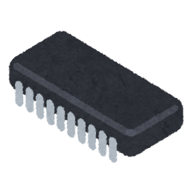
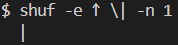

## はじめに

こんにちは，駄文を書き連ねる偽大学生 a.k.a. gotoです．

{width="200"}

皆さんはNOTとかORのIC買ったつもりでNANDだけ大量に買った経験はありませんか?

「よ～し買い物から帰ってきたぞ～～～！！」

「早速買ったICでいろいろするか～～！！！！」

{width="300"}(著作権とかの都合で画像はイメージです)  
「あっこれTC74HC14APじゃなくてTC74HC00APじゃん！！やっべぇ～ミスった～～～」  
ってことがある人もいると思います．

{width="300"}(著作権とかの都合で画像はイメージです)\
こっちがTC74HC14APです．全然違いますね

ですがそんなことをしたとしてもこの知識さえあれば大丈夫です

## NANDで工夫する

まず，前提知識として，NOT($\lnot$)，OR($\lor$)，AND($\land$)をいくつも組み合わせれば，あらゆる入出力はわりかしシンプルに表現できます．
加法標準形とか乗法標準形とか言うやつです．
つまり，NANDのみでこの3つを作ることができればミッションコンプリートですね．

(実際は，NOTとANDかORがあれば，ド・モルガンの法則で使ってないほうも作れるので別に3つ作る必要はないんですが)

NANDは$\uparrow$か$\mid$(シェファーの棒記号というらしい)という記号で表されます．  
今回は  
{width=200}  
天啓により$\mid$を採用します．

結論，

$$
\lnot A = A \mid A\\
A \land B = (A \mid B) \mid (A \mid B)\\
A \lor B = (A \mid A) \mid (B \mid B)
$$

で行けます．

これが本当に動作すればNANDだけですべてを表現できますね

パパっと確認してみましょう

## 真理値表を使う

はい，書きましょう

### NOT

| $A$ | $A \mid A$ |
| :-: | :--------: |
|  F  |     T      |
|  T  |     F      |

### AND

| $A$ | $B$ | $A \mid B$ | $(A \mid B) \mid (A \mid B)$ |
| :-: | :-: | :--------: | :--------------------------: |
|  F  |  F  |     T      |              F               |
|  F  |  T  |     T      |              F               |
|  T  |  F  |     T      |              F               |
|  T  |  T  |     F      |              T               |

### OR

| $A$ | $B$ | $A \mid A$ | $B \mid B$ | $(A \mid A) \mid (B \mid B)$ |
| :-: | :-: | :--------: | :--------: | :--------------------------: |
|  F  |  F  |     T      |     T      |              F               |
|  F  |  T  |     T      |     F      |              T               |
|  T  |  F  |     F      |     T      |              T               |
|  T  |  T  |     F      |     F      |              T               |

冗長ですが，書きました．
できてそうですね．
実際できてます．

## よく観察してみる(式変形)

真理値表とかを書かなくてもよく観察すると，NOTさえわかればANDとORはすぐにわかると思います．

### AND

まず，NANDは

$$
A \mid B = \lnot(A \land B)
$$

なので，同じものを2つ並べた $X \mid X$ を NOT($\lnot X$)と認めれば，
ANDは

$$
\begin{aligned}
(A \mid B) \mid (A \mid B) &= \lnot(A \land B) \mid \lnot(A \land B)\\
&= \lnot\lnot(A \land B)\\
&= (A \land B)
\end{aligned}
$$

と変形できます．

### OR

ORは

$$
\begin{aligned}
(A \mid A) \mid (B \mid B) &= \lnot A \mid \lnot B\\
&= \lnot(\lnot A \land \lnot B)\\
&= (\lnot\lnot A \lor \lnot\lnot B)\\
&= (A \lor B)
\end{aligned}
$$

です．2行目から3行目の変形はド・モルガンの法則です．

$$
\begin{aligned}
\lnot(A \land B) &= (\lnot A \lor \lnot B)\\
\lnot(A \lor B) &= (\lnot A \land \lnot B)
\end{aligned}
$$

これです．  
多分どこかで聞いたことがあると思います．詳しく知りたかったらググってください．

## おわりに

別にNORだけでもいいです．

完全性とか言われるやつです．ググってください．

あと，書いてる途中で気が付いたんですけど，wikipediaにほぼ同じ内容が書かれていたのでこれはほとんど劣化版ですね．終わりです．

## 参考リンク

https://akizukidenshi.com/catalog/g/g110923/

https://akizukidenshi.com/catalog/g/g110856/

https://ja.wikipedia.org/wiki/%E5%90%A6%E5%AE%9A%E8%AB%96%E7%90%86%E7%A9%8D
